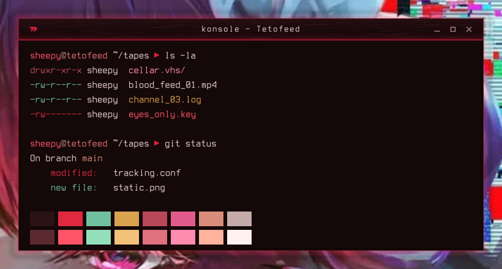
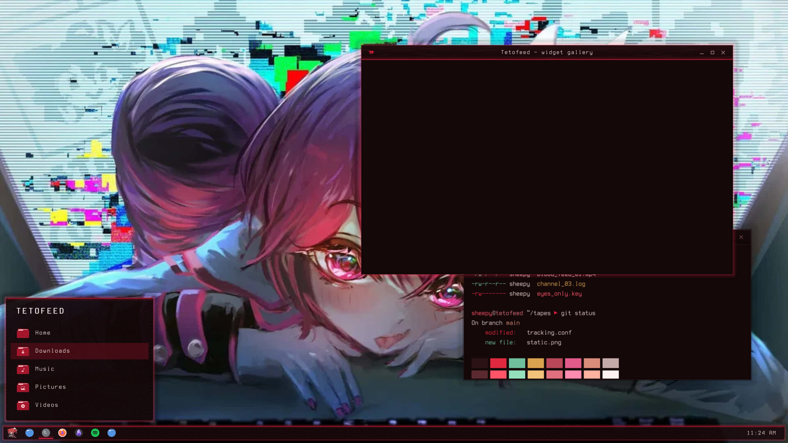

# Tetofeed — Konsole & kitty Colours

Blood-black terminal colours for Konsole and kitty, with a crimson cursor and a warm 16-colour palette.



Tetofeed is a red twindrilled VHS look for KDE Plasma 6, built around a crimson-lit face on near-black: blood-black surfaces, faint scanlines and tape grain, and a slight crimson glow on whatever has focus.

## Features

- A red-black background with bone text and a crimson block cursor.
- 16 colours tuned for the blood-black background: crimson, teal, amber, rose, pink and salmon, plus bright variants.
- A Konsole profile with Terminess, a slight translucency and blur, and roomy margins.
- A kitty theme with matching tab and border colours.



## Requirements

Konsole and/or kitty. The profile uses Terminess Nerd Font if it is installed.

## Install

```bash
git clone https://github.com/sheepy1335/tetofeed-konsole
cd tetofeed-konsole && ./install.sh
```

Or from the KDE Store: Copy `Tetofeed.colorscheme` and `Tetofeed.profile` to `~/.local/share/konsole/`, then pick the profile in Konsole. For kitty, add `include tetofeed-kitty.conf` to kitty.conf.

## The rest of the suite

| piece | repo |
|---|---|
| SDDM login | [tetofeed-sddm](https://github.com/sheepy1335/tetofeed-sddm) |
| Plymouth boot splash | [tetofeed-plymouth](https://github.com/sheepy1335/tetofeed-plymouth) |
| Global theme + splash screen | [tetofeed-global](https://github.com/sheepy1335/tetofeed-global) |
| Plasma splash screen | [tetofeed-splash](https://github.com/sheepy1335/tetofeed-splash) |
| Plasma style (panel, popups) | [tetofeed-plasma](https://github.com/sheepy1335/tetofeed-plasma) |
| Aurorae window decoration | [tetofeed-aurorae](https://github.com/sheepy1335/tetofeed-aurorae) |
| Colour scheme | [tetofeed-colors](https://github.com/sheepy1335/tetofeed-colors) |
| Kvantum widget style | [tetofeed-kvantum](https://github.com/sheepy1335/tetofeed-kvantum) |
| Icon theme | [tetofeed-icons](https://github.com/sheepy1335/tetofeed-icons) |

Everything at once, with the generators: [tetofeed](https://github.com/sheepy1335/tetofeed).

## Tags

`tetofeed` `kde` `plasma6` `dark` `vhs` `scanlines` `crimson` `red` `blood` `horror` `retro` `analog-horror` `glow` `konsole` `kitty` `terminal` `colorscheme` `terminal-theme`

## Credits and licence

By sheepy1335, customised from [Bloodfeed Konsole](https://github.com/numbpill3d/bloodfeed-konsole) by numbpill3d. GPL-3.0-or-later.
